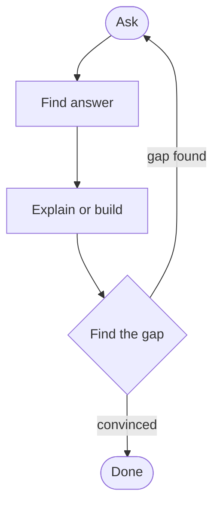

#type/guide #domain/general #status/completed #scope/fundamental
> [!abstract] Key Takeaways
> Learn through a loop of **asking, explaining in your own words, and building**, not by following a syllabus. Use layers to decide where to start, and use the right source for each job.

## Overview
School hands us a book and a syllabus and says "study this." But most of it fades because we never *used* it. That leaves a gap between what we **learn**, what we **understand**, and what we **remember**.

This note builds a framework to close that gap, one question at a time: learn faster, understand better, retain what's useful.

## Does hierarchy matter?
**Only as a map, not a ladder.** Start where you're curious; go deeper only when stuck.

Knowledge is built in **layers**. Each layer uses the one below it by *what it does*, not *how it works*. That's a **black box**: you use input → output without looking inside.

> [!example] CPU
> Transistors → Gates → Circuits → CPU → Instructions → Programs
> A programmer treats the CPU as a black box. An adder designer treats a gate as one. "Gates take 0s and 1s and return 0s and 1s" is enough to understand a CPU.

**How to use it**
1. Start at the layer that interests you
2. Learn what the layer below *does*, skip how
3. When stuck, drop **one layer**, learn only that piece, return

> [!tip] Hard dependency test
> Can I follow this without the prior thing?
> **Yes** → black box, move on. **No** → learn it first (e.g. algebra before calculus).

## Which sources to use?
**Learn from one, look up in others.** Each source has a different job.

| Source | Best for | Weakness |
|---|---|---|
| **YouTube** | Intuition, first exposure | Passive |
| **Books / courses** | Depth, correct order | Slow to start |
| **Official docs** | Accurate, current reference | Dry, assumes basics |
| **Web docs / blogs** | Quick fixes | Uneven quality |
| **AI** | Explaining, answering specific doubts | Can do your thinking for you |

**Match source to stage**
- **New** → video for the big picture
- **Understanding** → one book or course as the main path
- **Building** → official docs, web docs for quick fixes
- **Stuck** → search or ask AI

**A good source** starts at your level, has runnable examples, is recent, and comes from a trusted author.

> [!warning] Pitfall
> **Tutorial hopping.** Stick to one main source until done.

## Course, project, or simulation?
**Mix all three.** A course gives the path, a project gives purpose, a simulation gives a safe place to experiment.

| Approach | Strength | Weakness |
|---|---|---|
| **Course** | No gaps, clear order | Passive |
| **Project** | Motivation, real skill | Gaps, blind copying |
| **Simulation** | Instant feedback, free to fail | Can stay a toy |

> [!example] Learning a CPU
> Build a gate in a simulator → build an adder → combine into an ALU → a tiny CPU. You walk up the layers by building each one.

**Simulators**
- **Digital logic:** Logisim Evolution, CircuitVerse, Nand2Tetris
- **Electronics:** Falstad, Tinkercad, Wokwi
- **Science / math:** PhET, Desmos, GeoGebra
- **Networking:** Cisco Packet Tracer

> [!tip] Rule of thumb
> Learn a little → simulate → build → repeat. Don't finish the course before building, and don't build with no map.

## The Learning Framework
**Learning is a loop, not a line.** Repeat until you're *convinced*, not until the syllabus ends.

| Step | What you do |
|---|---|
| **Ask** | A narrow, specific question |
| **Find answer** | AI, search, video, book, docs |
| **Explain or build** | Write notes **in your own words**, or implement in hardware or a simulator |
| **Find the gap** | What doesn't make sense or doesn't match? |
| **Repeat** | Turn the gap into the next question |

> [!warning] AI answers. You explain.
> If AI also writes your notes, the thinking is skipped, and thinking is what makes it stick.

> [!example] How does an adder work?
> **Ask:** How does a computer add numbers? → **Answer:** half and full adders → **Build:** half adder in Logisim, notes in own words → **Gap:** why is there a carry output? → **Ask:** why carry matters for multi-bit addition → **Build:** 4-bit adder, output matches prediction → **Convinced.**

> [!tip] Test for "convinced"
> Can I explain it without looking, and does my build behave as I **predicted**?

**Habits**
- **Predict before you run.** A wrong guess exposes a gap fast.
- **Keep questions narrow.** "How does carry work?" beats "Explain CPUs."
- **Log your gaps.** They show where your understanding was weak.

## Related Links
### External
- [Beyond Potential | The Art of Becoming Dangerously Self-Educated](https://www.youtube.com/watch?v=48HQUVRlreQ)
- [Realith | The Art of Becoming Dangerously Self-Educated](https://www.youtube.com/watch?v=w8Qv9czi7j8)

