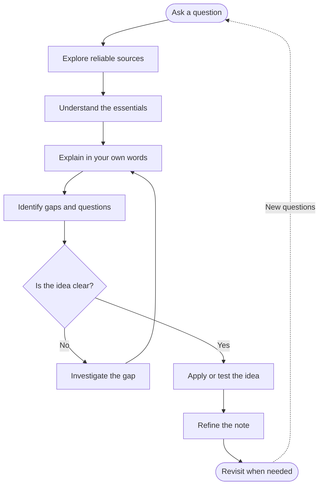

#type/guide #domain/general #status/completed #scope/fundamental
> [!abstract] Key Takeaways
> Good notes are built to **explain, connect, and resolve questions**, not to copy information. Focus on clarity, essential knowledge, and your own understanding.

## What Are Notes For?
Notes should bridge the gap between available information and your own understanding. Instead of reproducing books or videos, organize ideas in a way that makes them easier to understand, revisit, and apply.

## Principles of Note-Making

### 1. Understand Before You Write
Write in your own words and structure. Don't simply rephrase a source sentence by sentence. Organize the ideas in the way that makes the most sense to you.

> [!tip] Rule of thumb
> If you cannot explain an idea without looking at the source, you may need to understand it better before writing the note.

### 2. Focus on Essentials
Start with the fundamental idea and include the theory necessary to understand it. Once the basics are clear, organize additional explanations around specific questions.

> [!example]- Learning PID Control
> First explain what PID is and how P, I, and D work. Then add focused sections:
> - What causes integral windup?
> - How does anti-windup work?
> - Why can excessive proportional gain cause oscillations?
>
> Readers should be able to find the answer they need without going through unnecessary material.

### 3. Clarity Over Completeness
The goal is not to include everything known about a topic. It is to explain the necessary ideas clearly and correctly.

- Avoid unnecessary details.
- Include basic theory when it is needed for understanding.
- Prefer a clear explanation over a long, exhaustive one.

### 4. Connect Notes When Useful
Connections should help explain a concept or provide necessary background. Don't link every related topic just because a relationship exists.

> [!example]- Kalman Filter
> You may need a note on Gaussian distributions to understand measurement uncertainty. That doesn't mean you need to connect every topic in statistics to the Kalman filter.

**Let connections grow naturally as your knowledge expands.** Don't sacrifice clear notes to build a perfect-looking knowledge graph.

### 5. Record Questions and Difficulties
Your learning experience is valuable. Record the questions that confused you, the assumptions you got wrong, and how you resolved them.

> [!example]-
> **Question:** Why can increasing PID gain cause oscillations?
>
> **Resolution:** Explain how stronger corrections can cause overshoot and how system dynamics affect stability.

Don't leave these questions unanswered in your notes. If you haven't solved one yet, record it as an open question and return to it later.

### 6. Keep References
Record the sources you used so you can verify details or revisit an explanation when necessary.

Also, link relevant notes when they provide useful context or explain a prerequisite. Keep references and connections purposeful.

## The Note-Making Process

Learning and note-making should work together in a continuous loop.

>[!tip] My approach  
I use a **mapping approach** because I keep all my notes in a single Obsidian vault. I focus on making each note useful first, then connect it to other notes where those connections improve understanding.

>[!tip] Final Principle
Write notes to make knowledge easier to understand and use, not to make your collection bigger.

## Related Links
### External
- [Vicky Zhao|How To Take Smart Notes (3 methods no one's talking about)](https://www.youtube.com/watch?v=5O46Rqh5zHE)